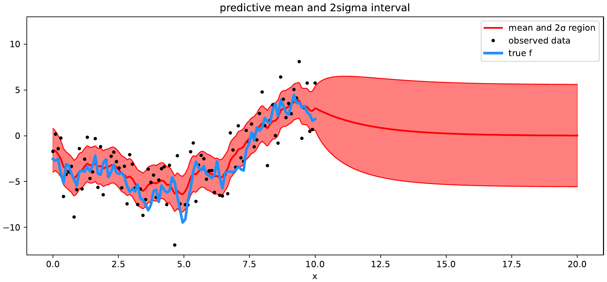

# Stochastic Processes: Credit Risk, Geometric Brownian Motion and Gaussian Processes

*A group project applying continuous-time Markov chains, stochastic price models, and Gaussian-process inference.*

## Descripción

Trabajo final de Procesos Estocásticos con tres componentes principales: estimación del tiempo de absorción de una cadena de Markov continua aplicada a categorías de riesgo crediticio, modelado de precios mediante movimiento Browniano geométrico y análisis de procesos gaussianos.

## ¿Qué incluye?

- Aproximación del generador infinitesimal de una cadena de Markov continua a partir de una matriz de transición.
- Cálculo del tiempo esperado de absorción desde la categoría crediticia AA.
- Análisis de una serie de precios de NVIDIA mediante movimiento Browniano geométrico (GBM).
- Simulación de trayectorias y evaluación de una barrera de precio.
- Visualización de distribuciones posteriores y predictivas de un proceso gaussiano.
- Informe final en PDF y fuente Quarto.

## Hallazgo principal

La aproximación de la cadena de Markov produce un tiempo medio de absorción cercano a **31,76 años** cuando el proceso inicia en la categoría AA, bajo los supuestos y la matriz de transición seleccionados en el trabajo.

## Herramientas

`R` · `Markov Chains` · `Geometric Brownian Motion` · `Gaussian Processes` · `Quarto`

## Reproducibilidad y datos

El PDF contiene los resultados finales de los tres componentes. La fuente Quarto conserva el código, pero el apartado de NVIDIA hace referencia a `NVDA.csv`, archivo que no venía en el ZIP. Por eso, ese apartado no puede regenerarse de extremo a extremo sin incorporar el conjunto de datos utilizado originalmente.

## Autoría

Trabajo realizado en equipo por Fernanda Bermeo Ruiz, Valentina Sierra y Juan Manuel Diaz Larrea. La copia pública omite los números de identificación que aparecían en la portada original.
