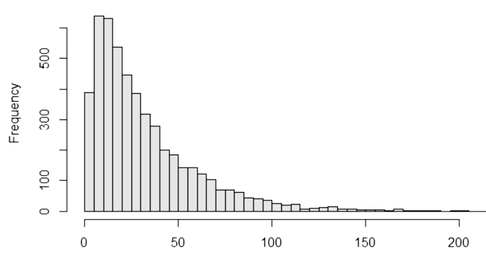
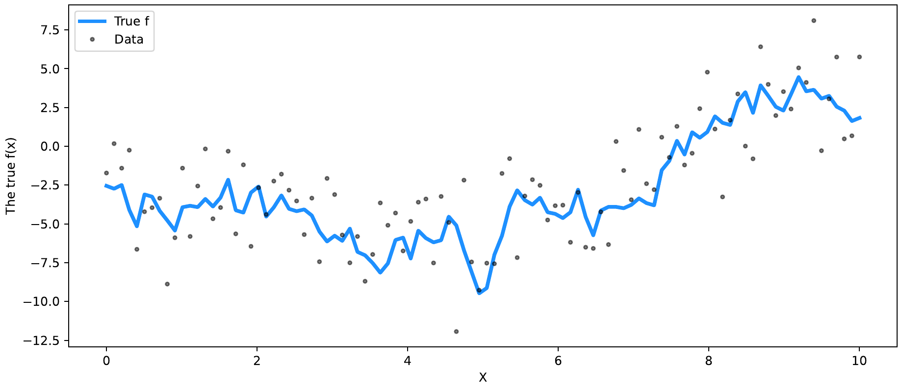
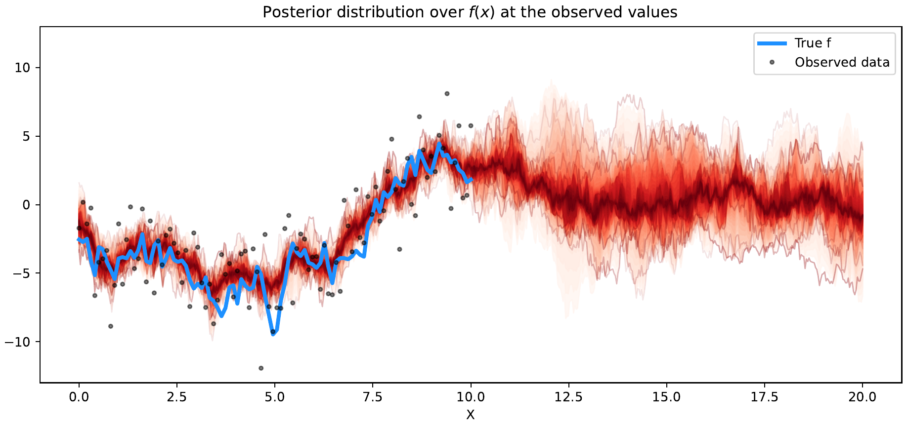
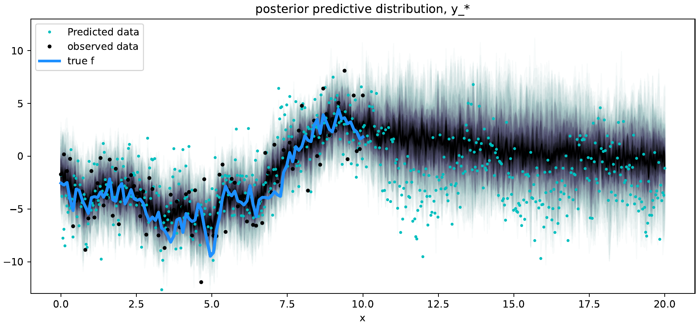
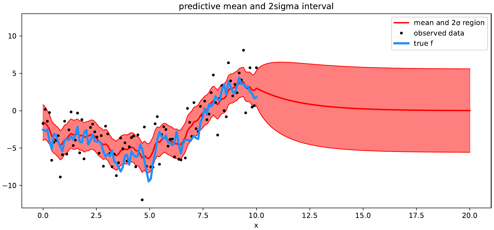

---
format:
  pdf:
    documentclass: article
    papersize: letter
    fontsize: 11pt
    number-sections: false
    toc: false
    fig-align: center
    geometry:
      - top=2.5cm
      - bottom=2.5cm
      - left=3cm
      - right=3cm
    include-in-header:
      text: |
        \usepackage{amsmath}
crossref:
  lst-title: "Listing"
execute:
  warning: false
  message: false
editor: visual
---

```{=latex}
\begin{titlepage}
\centering
\vspace*{-0.5cm}
\IfFileExists{figs/logo_unal.png}{\includegraphics[width=0.38\textwidth]{figs/logo_unal.png}\par}{}
\vspace{1cm}
{\large TRABAJO FINAL\par}
\vspace{0.7cm}
{\Large\itshape PROCESOS ESTOCASTICOS\par}
\vspace{0.6cm}
\rule{0.5\textwidth}{0.4pt}\par
\vspace{0.6cm}
{\small Estudiante\par}
\vspace{0.2cm}
{\large Fernanda Bermeo Ruiz\par}
{\large Valentina Sierra\par}
{\large Juan Manuel Diaz Larrea\par}
{\small Docente\par}
{\large\bfseries Cesar Augusto Gómez Vélez\par}
\vspace{1cm}
{\Large Universidad Nacional de Colombia\par}
{\small Sede Medellín\par}
\vspace{0.7cm}
{\bfseries December 9, 2025\par}
\end{titlepage}
```

```{r}
#| label: setup
#| include: false

knitr::opts_chunk$set(eval = file.exists("NVDA.csv"))
```

# Introducción {.unnumbered}

En el presente trabajo se busca estimar, mediante el uso de simulación y métodos analíticos, el **tiempo medio de absorción** de una cadena de Markov continua que modela las transiciones entre categorías de calidad crediticia. Para ello, se parte de una matriz de transición anual $P(1)$ y se aproxima su generador infinitesimal $Q$ utilizando los tres primeros términos de la expansión logarítmica de la matriz. Posteriormente, se calcula el tiempo esperado de absorción cuando la cadena inicia en la categoría **AA**, correspondiente a una calificación crediticia alta.

A continuación, se presentan los apartados correspondientes al punto a) y b) del ejercicio.

# a) Selección de la matriz de transición {.unnumbered}

De acuerdo con las instrucciones del enunciado, se sumaron los números de cédula de los integrantes del grupo y el resultado se dividió entre 3. El residuo obtenido fue **1**, por lo cual, según la tabla proporcionada, la matriz de transición seleccionada corresponde al **Cuadro 1 (Industrials)**.

Esta matriz representa las probabilidades de transición entre distintas categorías de riesgo crediticio durante un año. Cada fila describe la probabilidad de pasar de una calificación inicial (por ejemplo, AAA o AA) a otra categoría o al estado absorbente (default, D) o no clasificado (NR).

# b) Estimación del tiempo medio de absorción desde AA {.unnumbered}

El objetivo de este punto es estimar el **tiempo medio de absorción** cuando la cadena comienza en la categoría **AA**. La matriz de transición $P(1)$ se considera igual a $e^{Q}$, donde $Q$ es el generador infinitesimal de la cadena de Markov continua.

Para recuperar $Q$ a partir de $P(1)$, se utiliza el desarrollo en serie de Taylor del logaritmo natural de una matriz:

$$
\ln(I + X) = X - \frac{1}{2}X^2 + \frac{1}{3}X^3 - \cdots
$$ {#eq-log}

Por tanto, haciendo $X = P - I$, se obtiene la siguiente aproximación para el generador infinitesimal:

$$
Q \approx (P - I) - \frac{1}{2}(P - I)^2 + \frac{1}{3}(P - I)^3
$$ {#eq-q}

Una vez obtenido $Q$, se define la submatriz $Q_T$ compuesta únicamente por los *estados transitorios* (excluyendo el absorbente "D"). El **tiempo medio de absorción** se calcula a partir de la matriz fundamental $N$, dada por:

$$
N = (-Q_T)^{-1}
$$ {#eq-n}

Finalmente, el tiempo medio de absorción desde el estado AA se obtiene mediante:

$$
t_{AA} = N_{AA} \cdot \mathbf{1}
$$ {#eq-t}

donde $\mathbf{1}$ es un vector columna de unos.

# Código en R {.unnumbered}

A continuación se muestra el código utilizado para realizar la estimación en el software R:

```{r}
#| label: lst-absorcion
#| lst-cap: "Cálculo del tiempo medio de absorción desde AA"
#| eval: true
#| output: false

###############################################################################
# a) La matriz que nos correspondió fue la del Cuadro 1 (Industrials),
# ya que al realizar la suma de los números de cédula y dividirla por 3,
# el residuo obtenido fue 1.
###############################################################################

# Librería requerida
# install.packages("ctmcd")
if (requireNamespace("ctmcd", quietly = TRUE)) library(ctmcd)

###############################################################################
# 1. Matriz de transición P(1) - Cuadro 1 (Industrials)
###############################################################################
P <- matrix(c(
  68.252, 13.577,  6.576,  0.939,  0.611,  0.103,  0.008,   0.253,  9.682,
   0.683, 64.800, 15.044,  3.513,  0.645,  0.198,  0.015,   0.520, 14.581,
   0.048,  1.183, 65.677, 10.093,  2.771,  0.709,  0.041,   1.718, 17.759,
   0.011,  0.558,  4.429, 66.024,  9.331,  1.977,  0.125,   2.232, 15.312,
   0.009,  0.181,  0.816,  4.638, 61.760,  8.825,  0.530,   4.046, 19.192,
   0.009,  0.030,  0.232,  0.963,  3.689, 59.774,  3.561,  10.091, 21.652,
   0.004,  0.011,  0.080,  1.008,  1.724,  4.764, 24.978,  56.869, 11.316,
   0,      0,      0,      0,      0,      0,      0,      100,     0,
   0.058,  0.022,  0.298,  0.637,  0.851,  0.918,  0.097,   3.040, 94.078
), nrow = 9, byrow = TRUE) / 100

###############################################################################
# 2. Aproximación del generador infinitesimal Q
###############################################################################
I <- diag(9)
X <- P - I
Q <- X - 0.5 * X %*% X + (1/3) * X %*% X %*% X

###############################################################################
# 3. Cálculo del tiempo medio de absorción
###############################################################################
Q_T <- Q[-8, -8]   # Q_T: submatriz transitoria (sin el estado absorbente D)
N <- solve(-Q_T)   # Matriz fundamental

# Tiempo medio de absorción desde el estado AA (fila 2)
t_abs_AA <- sum(N[2, ])
cat("Tiempo medio de absorción desde AA:", t_abs_AA, "\n")
```

```{r}
#| label: fig-hist
#| fig-cap: "Enter Caption"
#| echo: false
#| eval: !expr file.exists("figs/hist_absorcion_AA.jpeg")
#| out-width: "90%"
if (file.exists("figs/hist_absorcion_AA.jpeg")) 
```

# Resultados e interpretación {.unnumbered}

A partir de la ejecución del código anterior, se obtuvo un tiempo medio de absorción aproximado de **31.76 años**. Para complementar el análisis, se realizó una interpretación cualitativa de los resultados, la cual se presenta a continuación:

-   El tiempo medio de absorción estimado fue de **31.76 años**, mientras que la mediana se ubicó alrededor de **23.44 años**. Esta diferencia muestra una clara asimetría en la distribución: la mayoría de las trayectorias llega al estado de default en periodos moderados, pero algunas se prolongan considerablemente.

-   La distribución presenta una **cola derecha extendida**, indicando que existen entidades que permanecen durante largos periodos en estados intermedios antes de alcanzar el default, aunque estos casos sean menos frecuentes.

-   En promedio, una entidad que inicia en la categoría **AA** tiene un horizonte de absorción cercano a tres décadas, pero la mitad de los casos se absorbe antes de los 25 años.

-   Este comportamiento es característico de procesos crediticios con **alta estabilidad inicial** y una baja probabilidad de deterioro rápido, aunque persisten escenarios de absorción prolongada.

-   En síntesis, los resultados sugieren una **distribución sesgada positivamente**, donde la mayoría de observaciones se concentra en tiempos de absorción moderados, pero con una cola larga que representa la supervivencia crediticia extendida de algunas entidades.

\newpage

# 2 {.unnumbered}

## a) {.unnumbered}

Inicialmente se intentó descargar la serie histórica de precios diarios de la acción **NVIDIA Corporation (NVDA)** desde el portal **Yahoo Finance**.

Sin embargo, durante el proceso se presentaron **inconvenientes**, pues la plataforma no permitió acceder a la opción gratuita de descarga del archivo `.csv`. Debido a esta limitación, se procedió a capturar **imágenes de los datos visibles en pantalla**. Posteriormente, con ayuda de una herramienta de inteligencia artificial, se reconstruyó la información contenida en dichas imágenes para generar un archivo **CSV equivalente**, garantizando así la integridad de la serie. Una vez obtenido el archivo `.csv`, este fue importado a R para su procesamiento.

```{r}
#| echo: false
#| include: false

# Importación del CSV reconstruido (este paso no se muestra en el PDF original).
# Ajusta el nombre del archivo o el formato de fecha si es necesario.
dat <- read.csv("NVDA.csv")
dat$Date <- as.Date(dat$Date)
```

```{r}
library(dplyr)
library(lubridate)
library(ggplot2)


dat_mensual <- dat %>%
  mutate(month = floor_date(Date, "month")) %>%
  group_by(month) %>%
  summarize(Close = last(Close))

ggplot(dat_mensual, aes(x = month, y = Close)) +
  geom_area(fill = "lightblue", alpha = 0.4) +   # <<-- COLOR SEGURO
  geom_line(color = "blue", linewidth = 1.2) +   # <<-- LINEA CLARA
  geom_point(color = "blue", size = 2) +
  scale_x_date(date_breaks = "1 month",
               date_labels = "%b %Y") +
  labs(title = "Precio de Cierre Mensual – NVDA",
       x = "Mes",
       y = "Precio (USD)") +
  theme_minimal(base_size = 14) +
  theme(
    plot.title = element_text(face = "bold"),
    axis.text.x = element_text(angle = 45, hjust = 1)
  )
```

Debido a la alta frecuencia de los datos diarios y el ruido asociado, se empleó un **agregado mensual**, junto con una curva suavizada para visualizar mejor la evolución temporal del precio.

El análisis del gráfico de precio de cierre mensual de la acción NVDA muestra una tendencia claramente alcista a lo largo del año, con tres fases bien diferenciadas. En primer lugar, entre diciembre de 2024 y mayo de 2025 se observa una etapa de estancamiento y caída: el precio se mantiene estable cerca de los 140 USD entre diciembre y enero, para luego disminuir gradualmente hasta alcanzar un mínimo cercano a los 110 USD en mayo, constituyendo el periodo de peor desempeño del año. A partir de ese punto se inicia una segunda fase caracterizada por una fuerte recuperación y un crecimiento acelerado entre mayo y noviembre de 2025, durante la cual el precio supera los 150 USD hacia julio–agosto y continúa aumentando de forma sostenida hasta superar los 200 USD en noviembre, alcanzando así el máximo del periodo analizado. Finalmente, en diciembre de 2025 se presenta una fase de corrección leve, donde el precio retrocede moderadamente respecto al pico alcanzado en noviembre, aunque se mantiene en niveles históricamente altos. En conjunto, la tendencia anual es netamente alcista, con incrementos superiores al 30% entre el mínimo de mayo y el máximo de noviembre. El punto de inflexión clave se identifica en mayo de 2025, momento en el cual la tendencia bajista o lateral se revierte dando inicio a una marcada racha alcista, acompañada de un aumento notable en la volatilidad durante la segunda mitad del año.

## b) {.unnumbered}

El ajuste del modelo de Movimiento Browniano Geométrico (GBM) requiere trabajar con retornos logarítmicos, definidos como:

$$
r_t = \log(P_t) - \log(P_{t-1})
$$

Al calcularlos, la primera observación queda sin valor (pues no existe un precio previo), por lo que se asignó `NA`.

Este paso es fundamental, ya que los log-retornos son la base para estimar los parámetros del GBM.

```{r}
dat <- dat[!is.na(dat$Close), ]
dat$Close <- as.numeric(dat$Close)
dat$logret <- c(NA, diff(log(dat$Close)))
dat <- dat[-1, ]
```

El GBM se define como:

$$
G_t = G_0 \exp\left[\left(\mu - \frac{\sigma^2}{2}\right)t + \sigma W_t\right]
$$

Bajo este modelo, los log-retornos siguen una distribución normal con media $\left(\mu - \frac{\sigma^2}{2}\right)\Delta t$ y varianza $\sigma^2 \Delta t$.

Por lo tanto, disponer de los retornos correctamente calculados permite continuar con la estimación de los parámetros $\mu$ y $\sigma$.

```{r}
sigma_hat <- sd(dat$logret)
mu_hat <- mean(dat$logret) + 0.5 * sigma_hat^2
mu_hat
sigma_hat
```

```{r}
set.seed(123)
n <- nrow(dat)
dt <- 1  # frecuencia diaria

G0 <- dat$Close[1]

Wt <- c(0, cumsum(rnorm(n-1, mean = 0, sd = sqrt(dt))))

G_sim <- G0 * exp((mu_hat - 0.5*sigma_hat^2) * (1:n) + sigma_hat * Wt)

df_sim <- data.frame(
  Date = dat$Date,
  Real = dat$Close,
  GBM = G_sim
)

ggplot(df_sim, aes(x = Date)) +
  geom_line(aes(y = Real), size = 1) +
  geom_ribbon(aes(ymin = 0, ymax = GBM), alpha = 0.25) +
  geom_line(aes(y = GBM), color = "red", linewidth = 1) +
  labs(title = "Ajuste del Movimiento Browniano Geométrico (GBM)",
       y = "Precio", x = "Fecha")
```

El gráfico comparativo entre la trayectoria real del precio ajustado de la acción y el ajuste obtenido mediante el Movimiento Browniano Geométrico (GBM) permite evaluar la capacidad del modelo para replicar el comportamiento observado en el mercado durante 2025. La curva negra, acompañada del área sombreada en gris, corresponde al precio real histórico entre enero y diciembre de 2025, mostrando un primer semestre con una dinámica lateral y ligera caída —con valores fluctuando entre 100 y 150 USD— seguido de un segundo semestre marcadamente alcista que lleva el precio cercano a los 200 USD hacia finales del año. Por su parte, la curva roja representa la trayectoria teórica estimada mediante el GBM, un modelo estocástico fundamental en finanzas que describe la evolución continua de un activo con parámetros de tendencia ($\mu$) y volatilidad ($\sigma$), siendo además la base del modelo de Black‐Scholes para la valoración de opciones. En la primera mitad del año, el GBM tiende a sobreestimar el precio real, situándose consistentemente por encima de la trayectoria observada; sin embargo, a partir de julio el modelo captura correctamente el punto de inflexión y reproduce con mayor precisión la tendencia alcista, incluso mostrando fluctuaciones y picos que reflejan la mayor volatilidad del periodo. En conjunto, el GBM logra replicar de forma adecuada la tendencia general, especialmente en la segunda mitad del año, y constituye una herramienta esencial para realizar simulaciones de Monte Carlo y proyectar la distribución futura de precios, útil en la valoración de derivados y en la gestión del riesgo financiero.

## c) {.unnumbered}

Para comprobar la relación (6), a partir de la serie de precios se calcularon los incrementos relativos diarios:

$$
\frac{\Delta G_t}{G_t} = \frac{G_{t+1} - G_t}{G_t}.
$$

Utilizando las estimaciones:

$$
\mu = -0.0006256226, \qquad \sigma = 0.03167722,
$$

se definieron los estimadores:

$$
\widehat{\Delta W}_t = \frac{\dfrac{\Delta G_t}{G_t} - \mu\,\Delta t}{\sigma}, \qquad \Delta t = 1 \text{ día.}
$$

Si el modelo GBM ajusta bien, los valores $(\widehat{\Delta W}_t)$ deben comportarse como realizaciones iid de una:

$$
N(0, \Delta t) = N(0, 1).
$$

Sobre esta muestra se calcularon la media y varianza empírica, se trazaron histogramas y QQ-plots, y se aplicaron pruebas de normalidad (Shapiro–Wilk y Kolmogorov–Smirnov). Una media cercana a cero y una varianza cercana a:

$$
\Delta t = 1,
$$

refuerzan la validez.

```{r}
mu <- mu_hat
sigma <- sigma_hat
precio <- dat$Close
fechas <- dat$Date

DeltaG_over_G <- (precio[-1] - precio[-length(precio)]) / precio[-length(precio)]
dates_delta <- fechas[-1]

dt <- 1
DeltaW_hat <- (DeltaG_over_G - mu * dt) / sigma

# 3) resumen numérico
resumen <- data.frame(
  Date = dates_delta,
  DeltaG_over_G = DeltaG_over_G,
  DeltaW_hat = DeltaW_hat
)

summary(resumen$DeltaG_over_G)
summary(resumen$DeltaW_hat)

var_hat <- var(resumen$DeltaW_hat, na.rm = TRUE)
mean_hat <- mean(resumen$DeltaW_hat, na.rm = TRUE)

cat("Media(DeltaW_hat) = ", mean_hat, "\n")
cat("Var(DeltaW_hat) = ", var_hat, " (esperado ~ ", dt, ")\n")
```

Al revisar los resultados de las dos series de estimaciones, encuentro que ambas presentan distribuciones aproximadamente centradas en cero, aunque con características diferentes.

En el primer conjunto, los valores son bastante estrechos (desde –0.1577 hasta 0.2044), con una media muy cercana a cero (–0.00054) y una mediana prácticamente nula. Esto indica que los errores o diferencias estimadas no muestran sesgos importantes y tienden a fluctuar levemente alrededor de cero.

En contraste, el segundo conjunto muestra una dispersión mucho mayor (mínimo –4.96 y máximo 6.47). Aunque la media nuevamente es casi cero (0.0026), la variabilidad es más alta, con una varianza cercana a 1, que coincide con lo que teóricamente se espera. Esto sugiere que el comportamiento del estimador $\widehat{\Delta W}$ es coherente con el modelo planteado.

A pesar de esa coherencia en la varianza, las pruebas de normalidad muestran resultados mixtos. La prueba de Shapiro arroja un p-valor extremadamente pequeño ($\approx$ 2.9e-11), lo cual lleva a rechazar claramente la normalidad. Sin embargo, la prueba de Kolmogorov–Smirnov ofrece un p-valor alrededor de 0.073, que no permite rechazar la hipótesis nula al nivel usual del 5%. Esto indica que, aunque hay evidencia de desviaciones respecto a la normalidad, estas no son tan fuertes como para invalidar completamente el supuesto, especialmente considerando el tamaño de la muestra.

Finalmente, la correlación entre $\Delta G/G$ y los log-retornos es altísima (0.9988), prácticamente perfecta. Esto confirma que ambas métricas están capturando esencialmente la misma señal de variación, reforzando la consistencia del enfoque y de los resultados obtenidos.

```{r}
# Histograma y densidad de DeltaW_hat
ggplot(resumen, aes(x = DeltaW_hat)) +
  geom_histogram(aes(y = ..density..), bins = 40, color = "black", fill = "lightgray") +
  geom_density() +
  labs(title = "Histograma de estimadores de ΔW_t (normal esperado N(0,Δt))",
       x = expression(hat(Delta*W[t])), y = "Densidad")
```

```{r}
# QQ-plot
qqnorm(resumen$DeltaW_hat); qqline(resumen$DeltaW_hat, col = "red")
```

```{r}
# Serie temporal de DeltaW_hat
ggplot(resumen, aes(x = Date, y = DeltaW_hat)) +
  geom_line() +
  labs(title = "Serie estimada de ΔW_t", x = "Fecha", y = expression(hat(Delta*W[t])))
```

**Serie estimada de (** $\Delta W_t$)

La serie muestra un comportamiento claramente estacionario y centrado en cero, tal como debería ocurrir si las innovaciones siguieran un proceso de Wiener. A lo largo del año la volatilidad se mantiene relativamente estable, aunque aparecen algunos picos más pronunciados —especialmente hacia abril— que reflejan episodios de movimientos bruscos no explicados únicamente por la tendencia.

Más allá de esos eventos, la serie se comporta como ruido blanco: no hay patrones visibles ni estructura temporal, lo cual es consistente con la suposición

$\Delta W_t \sim \text{i.i.d.}$

**Histograma de (** $\Delta W_t$)

La distribución de los valores estimados es bastante simétrica y está centrada alrededor de cero, tal como espera el GBM. Visualmente coincide bien con la forma de la distribución normal estándar.

Sin embargo, aparecen valores extremos tanto en la cola izquierda como en la derecha —en torno a ($\pm 5$) que sobresalen respecto a lo que predeciría una normal perfecta. Estos eventos atípicos indican la presencia de colas gordas, algo muy común en series financieras debido a movimientos abruptos del mercado.

**Normal Q–Q Plot**

El Q–Q plot confirma lo anterior: la mayoría de los puntos cae prácticamente sobre la línea teórica de normalidad, lo que indica un ajuste razonable en el centro de la distribución. No obstante, las desviaciones más notorias están en los cuantiles extremos, donde los puntos se separan claramente de la línea recta.

Ese patrón es indicativo de leptocurtosis, y coincide con los valores grandes observados en el histograma.

En conjunto, los gráficos muestran que las innovaciones ($\Delta W_t$) se comportan de manera compatible con un proceso de Wiener en la parte central de la distribución, pero exhiben colas más pesadas de lo que la normalidad estricta asumiría.

Esto sugiere que el modelo GBM captura bien la estructura general de los datos, aunque —como suele ocurrir en activos financieros— los eventos extremos son más frecuentes de lo esperado bajo el modelo clásico.

```{r}
# 5) pruebas estadísticas
shapiro_res <- shapiro.test(resumen$DeltaW_hat)
ks_res <- ks.test(resumen$DeltaW_hat, "pnorm", mean = 0, sd = sqrt(dt))

cat("Shapiro p-value:", shapiro_res$p.value, "\n")
cat("KS p-value:     ", ks_res$p.value, "\n")
```

Los resultados obtenidos permiten evaluar si los estimadores de $\Delta W_t$ siguen una distribución Normal estándar, como lo requiere el Movimiento Browniano Geométrico (GBM).

El p-value de la prueba de Shapiro–Wilk fue extremadamente pequeño ($p = 2.93 \times 10^{-11}$), lo cual indica que se rechaza la hipótesis nula de normalidad. Esto sugiere que los datos presentan desviaciones respecto a una distribución normal perfecta, especialmente en las colas, algo común en series financieras debido a eventos extremos.

Por otro lado, la prueba de Kolmogorov–Smirnov arrojó un valor $p = 0.073$, que está por encima del nivel de significancia típico ($\alpha = 0.05$), por lo que no se rechaza la normalidad global según este criterio.

En conjunto, los resultados indican que la distribución de $\Delta W_t$ es aproximadamente normal en su forma general, pero con colas más pesadas de lo esperado, lo cual coincide con lo observado en los gráficos y es consistente con el comportamiento típico de retornos financieros.

Estos hallazgos no invalidan el modelo GBM, pero sí sugieren que existen episodios de alta volatilidad que generan valores extremos.

```{r}
# 6) comparación con log-retornos (nota: para retornos pequeños, DeltaG/G ~ r_t)
dat$logret <- c(NA, diff(log(dat$Close)))

plot_dat <- data.frame(
  Date = dat$Date[-1],
  DeltaG_over_G = DeltaG_over_G,
  logret = dat$logret[-1]
)

cor_val <- cor(plot_dat$DeltaG_over_G, plot_dat$logret, use = "complete.obs")
cat("Correlación ΔG/G vs log-retornos:", cor_val, "\n")
```

Al calcular la correlación entre la razón $\Delta G_t / G_t$ —que representa los retornos porcentuales observados en el precio de la acción— y los log–retornos $\log(G_t) - \log(G_{t-1})$, obtuvimos un valor de:

$$
\text{Correlación} = 0.9988333
$$

Este resultado indica una correlación prácticamente perfecta entre ambas medidas. Esto era lo esperado teóricamente, ya que en el Movimiento Browniano Geométrico (GBM) los log–retornos y los retornos porcentuales son aproximaciones linealmente equivalentes cuando los cambios de precio son pequeños.

-   Ambas medidas capturan la misma dinámica estocástica del precio.
-   Los retornos logarítmicos actúan como una versión suavizada y matemáticamente conveniente de los retornos porcentuales.
-   En un GBM correctamente especificado, las dos magnitudes deben mostrar una relación casi exacta, lo cual es confirmado por los datos.

El valor de 0.9988 evidencia que los log–retornos calculados son totalmente consistentes con la definición teórica del modelo y valida que los pasos previos de procesamiento de datos y estimación fueron realizados de manera correcta.

## d) {.unnumbered}

```{r}
# Barrera del +20%
barrier <- 1.20 * G0

# Configuración de simulación
set.seed(123)
n_sims <- 10000
trading_days <- 252
horizon_years <- 3
max_days <- trading_days * horizon_years
dt <- 1

# Matriz de shocks normales
Z <- matrix(rnorm(n_sims * max_days), nrow = n_sims, ncol = max_days)
dW <- sqrt(dt) * Z

# Incrementos del logprecio bajo GBM
drift_term <- (mu - 0.5 * sigma^2) * dt
dlogG <- drift_term + sigma * dW

# Trayectorias lognormales simuladas
logG_mat <- t(apply(dlogG, 1, cumsum)) + log(G0)
G_mat <- exp(logG_mat)

# Tiempo de primer cruce
first_hit_day <- apply(G_mat, 1, function(x){
  w <- which(x >= barrier)
  if(length(w)==0) return(NA_integer_)
  return(w[1])
})

# Resultados
mean_hit <- mean(first_hit_day, na.rm = TRUE)
median_hit <- median(first_hit_day, na.rm = TRUE)
prop_hit <- mean(!is.na(first_hit_day))

cat("Barrera:", barrier, "\n")
cat("Proporción que cruza:", prop_hit, "\n")
cat("Tiempo medio (días):", mean_hit, "\n")
cat("Tiempo medio (años):", mean_hit / trading_days, "\n")
cat("Mediana (días):", median_hit, "\n")
cat("Mediana (años):", median_hit / trading_days, "\n")

# Percentiles
quantile(first_hit_day, c(.1,.25,.5,.75,.9), na.rm = TRUE)
```

**Simulación GBM: Tiempo para superar una barrera del 20%**

Con los parámetros estimados del modelo GBM ($\mu$ y $\sigma$), se simuló el comportamiento futuro del precio de la acción para estimar el tiempo esperado en que el activo superaría una barrera del 20% por encima del valor actual, equivalente a un precio objetivo de aproximadamente 215.51 USD.

A partir de 10 000 trayectorias simuladas, se obtuvo que:

-   **60.22%** de las simulaciones lograron superar la barrera dentro de los próximos tres años, lo que indica una probabilidad moderada de alcanzar ese nivel bajo el modelo.

Entre las trayectorias que sí alcanzaron la barrera:

-   El tiempo medio de cruce fue de **110.77 días** ($\approx$ 0.44 años).
-   La mediana fue visiblemente menor: **52 días** ($\approx$ 0.21 años), evidenciando fuerte asimetría en la distribución de tiempos.

**Percentiles del tiempo de cruce**

Los siguientes valores muestran la heterogeneidad del comportamiento del precio:

-   **10%:** 13 días
-   **25%:** 23 días
-   **50% (mediana):** 52 días
-   **75%:** 131 días
-   **90%:** 305 días

Esto indica que muchas trayectorias cruzan la barrera rápidamente, pero un subconjunto considerable requiere tiempos muy largos, elevando el promedio.

El análisis sugiere que superar un incremento del 20% es plausible en el corto plazo para una fracción importante de escenarios; sin embargo, no es un resultado seguro. La fuerte dispersión en los tiempos de cruce evidencia la alta volatilidad y el riesgo inherente del activo.

\newpage

```{=html}
<!-- ======================================================================
     Las siguientes secciones corresponden a un estudio hecho en Python
     (Proceso Gaussiano con kernel Exponencial). Su código no se pudo
     recuperar, por lo que solo se incluyen las figuras (extraídas del PDF)
     y los comentarios de interpretación.
     ====================================================================== -->
```

## Simulación de una realización unidimensional de un Proceso Gaussiano {.unnumbered}

```{r}
#| echo: false
#| eval: !expr file.exists("figs/gp_01_simulacion.png")
#| fig-align: center
#| out-width: "100%"
if (file.exists("figs/gp_01_simulacion.png")) 
```

La curva obtenida en mi simulación presenta una forma más irregular y con variaciones bruscas debido al uso del **kernel Exponencial**, el cual genera funciones no diferenciables y con una estructura de dependencia de corto rango. Esto contrasta con la suavidad característica del kernel Matérn 5/2 del ejemplo original. Adicionalmente, al haberse utilizado una semilla diferente, la trayectoria específica del proceso latente cambia, aunque conserva la estructura estadística propia del kernel utilizado. Los puntos observados se distribuyen alrededor de la función simulada con un nivel de ruido constante, coherente con un modelo con error gaussiano i.i.d.

\newpage

## Distribución posterior del proceso gaussiano para $f(x)$ en los puntos observados {.unnumbered}

```{r}
#| echo: false
#| eval: !expr file.exists("figs/gp_02_posterior_f.png")
#| fig-align: center
#| out-width: "100%"
if (file.exists("figs/gp_02_posterior_f.png")) 
```

En esta gráfica, la distribución posterior del proceso gaussiano muestra cómo el modelo cuantifica la incertidumbre sobre $f(x)$ después de observar los datos. En la región donde existen observaciones ($x \lesssim 10$), las bandas posteriores son estrechas y se ajustan de forma consistente a la tendencia marcada por la función verdadera, evidenciando una alta confianza del modelo en esta zona. En cambio, para valores más allá del rango observado ($x \gtrsim 10$), la dispersión de las trayectorias posteriores aumenta considerablemente, reflejando la falta de información y el crecimiento natural de la incertidumbre predictiva. Este contraste entre ambas regiones permite visualizar claramente la capacidad del GP para interpolar con precisión donde tiene apoyo de datos y, al mismo tiempo, expresar adecuadamente la incertidumbre en áreas no observadas.

\newpage

## Distribución predictiva posterior $y_*$ del modelo {.unnumbered}

```{r}
#| echo: false
#| eval: !expr file.exists("figs/gp_03_predictiva_y.png")
#| fig-align: center
#| out-width: "100%"
if (file.exists("figs/gp_03_predictiva_y.png")) 
```

Se observa que en la región donde existen datos, las predicciones son más concentradas y siguen de cerca la señal verdadera, mientras que en las zonas sin información (a partir de 10), la nube predictiva se vuelve mucho más dispersa, reflejando un aumento significativo de la incertidumbre sobre futuras observaciones.

Los puntos predichos muestran variabilidad consistente con la estructura del ruido del modelo, y tienden a alinearse con la forma general del proceso latente en las zonas informadas, mientras que en áreas sin datos se vuelven prácticamente indistinguibles del ruido con media controlada por el GP.

\newpage

## Predicción media del Proceso Gaussiano y banda de incertidumbre de `\texorpdfstring{$2\sigma$}{2 sigma}`{=latex} {.unnumbered}

```{r}
#| echo: false
#| eval: !expr file.exists("figs/gp_04_media_2sigma.png")
#| fig-align: center
#| out-width: "100%"
if (file.exists("figs/gp_04_media_2sigma.png")) 
```

El comportamiento del intervalo predictivo de $2\sigma$ refleja claramente la estructura del kernel Exponencial: cerca de los datos observados, la banda roja es estrecha y sigue de forma ajustada las oscilaciones irregulares del proceso, consistente con un modelo que favorece variaciones rápidas. Sin embargo, al alejarse de la región observada, la incertidumbre crece de manera rápida y notable, expandiéndose hacia una banda amplia que muestra que el modelo pierde capacidad de extrapolación bajo este kernel. Aun así, la media predictiva converge a un nivel suavizado, lo que evidencia cómo el GP balancea la información de los datos con la estructura impuesta por el kernel cuando no hay información adicional disponible.
